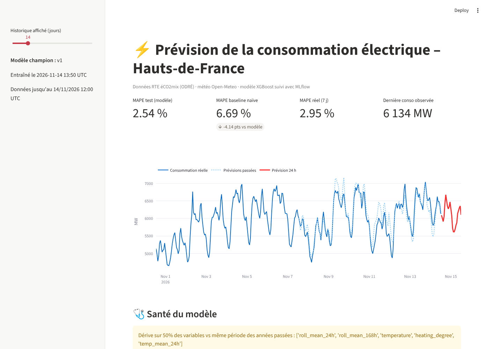
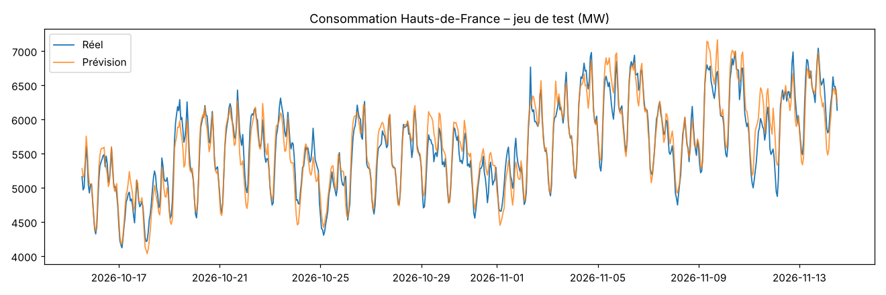
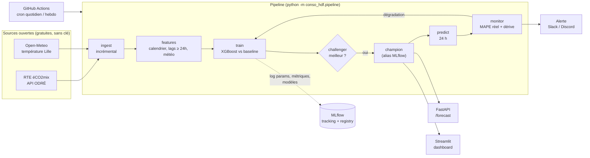

# ⚡ Prévision de la consommation électrique des Hauts-de-France — projet MLOps

> Pipeline MLOps complet, de l'ingestion de données ouvertes jusqu'au monitoring en production :
> le modèle prévoit **heure par heure la consommation électrique régionale des 24 prochaines heures**,
> se réentraîne, se compare à la version en production et surveille sa propre dérive.

 
 
 



---

## 📌 Sommaire
1. [Contexte et objectif](#-contexte-et-objectif)
2. [Résultats](#-résultats)
3. [Architecture](#-architecture)
4. [Données](#-données)
5. [Installation](#-installation)
6. [Utilisation](#-utilisation)
7. [Détails techniques](#-détails-techniques)
8. [Structure du dépôt](#-structure-du-dépôt)
9. [Limites et pistes d'amélioration](#-limites-et-pistes-damélioration)

La note de cadrage (POC) du projet est disponible dans [`docs/Note_de_cadrage_POC.pdf`](docs/Note_de_cadrage_POC.pdf).

---

## 🎯 Contexte et objectif

L'équilibre du réseau électrique exige de savoir **à l'avance** combien d'électricité sera consommée :
c'est ce qui permet aux gestionnaires de réseau, fournisseurs et grands consommateurs de planifier la
production, d'acheter au bon moment et d'éviter les tensions sur le réseau.

**Objectif :** prévoir la consommation horaire des Hauts-de-France à J+1 (24 h) avec une erreur moyenne
inférieure à 5 %, dans un système **automatisé, traçable et surveillé**, et pas seulement dans un notebook.

Le vrai sujet du projet est donc le **cycle de vie du modèle** :

| Étape | Ce que fait le projet |
|---|---|
| Ingestion | Récupère automatiquement les nouvelles données RTE et météo (incrémental) |
| Entraînement | XGBoost + baseline, avec un découpage temporel sans fuite de données |
| Suivi d'expériences | Paramètres, métriques, graphiques et modèles versionnés dans **MLflow** |
| Promotion | Le nouveau modèle (challenger) ne remplace le modèle en production (champion) **que s'il est meilleur** |
| Service | **API FastAPI** + **dashboard Streamlit** |
| Monitoring | Erreur réelle (prévu vs observé) + dérive des données avec **Evidently**, alertes webhook |
| Automatisation | Pipeline quotidien / hebdomadaire (**GitHub Actions**), tests et lint en **CI**, **Docker** |

---

## 📊 Résultats

Jeu de test = 30 derniers jours (mi-octobre → mi-novembre 2026), jamais vus pendant l'entraînement
(ni pour l'apprentissage, ni pour l'early stopping).

| Modèle | MAE (MW) | RMSE (MW) | MAPE |
|---|---|---|---|
| Baseline naïve (même heure, semaine précédente) | 386 | 468 | 6,69 % |
| **XGBoost + calendrier + météo** | **142** | **181** | **2,54 %** |

➡️ **L'erreur est divisée par 2,6 par rapport à la baseline**, et l'objectif de MAPE < 5 % est atteint.

> ⚠️ **Lecture honnête de ces chiffres.** Sur le jeu de test, la température utilisée est la température
> **observée**. En production, le modèle reçoit la température **prévue** (Open-Meteo, J+1), un peu moins
> précise : l'erreur réelle attendue est donc légèrement supérieure à 2,54 %.
> De même, le MAPE de 2,95 % sur 7 jours a été mesuré sur des prévisions **simulées** (backfill, avec la
> température observée), pas sur des prévisions réellement émises la veille. Le dashboard et l'API
> indiquent explicitement quand le MAPE de monitoring inclut des prévisions simulées ;
> il ne devient un « MAPE réel » qu'après quelques jours de fonctionnement du pipeline quotidien.



**Exemple de monitoring utile :** début novembre 2026, le système a levé un *avertissement de dérive*
(températures nettement plus froides que la même période des années précédentes : 6,4 °C contre ~9-10 °C).
Comme l'erreur mesurée restait sous le seuil (2,95 % < 5 %, sur prévisions simulées), **aucun réentraînement n'a été déclenché** :
le modèle généralise bien à ces conditions. C'est exactement le comportement attendu d'un monitoring
qui distingue « les données changent » de « le modèle se trompe ».

---

## 🏗 Architecture



**Planification :**
- **Tous les jours** (`daily`) : ingestion → évaluation des prévisions de la veille → réentraînement si la performance se dégrade → nouvelle prévision 24 h
- **Chaque lundi** (`weekly`) : ingestion → réentraînement → comparaison au champion → prévision

---

## 🗂 Données

| Source | Contenu | Pas de temps | Accès |
|---|---|---|---|
| [éCO2mix régional consolidé/définitif](https://odre.opendatasoft.com/explore/dataset/eco2mix-regional-cons-def/) | Consommation Hauts-de-France depuis 2013 | 30 min | API ODRÉ, sans clé |
| [éCO2mix régional temps réel](https://odre.opendatasoft.com/explore/dataset/eco2mix-regional-tr/) | Derniers mois, mis à jour en continu | 15 min | API ODRÉ, sans clé |
| [Open-Meteo](https://open-meteo.com/) (archive + prévision) | Température horaire à Lille | 1 h | API, sans clé |

Les deux jeux RTE sont fusionnés (priorité aux données consolidées, plus fiables), puis agrégés au pas horaire.
L'ingestion est **incrémentale** : seules les nouvelles données sont téléchargées.

---

## 🚀 Installation

**Prérequis :** Python **3.10 à 3.12**, 3.11 recommandé : c'est la version de la CI et de Docker
(en 3.13+, certaines dépendances comme MLflow ou Evidently peuvent ne pas avoir de wheels). Docker en option.

```bash
git clone https://github.com/mila1515/conso-hdf-mlops.git
cd conso-hdf-mlops

python -m venv .venv
source .venv/bin/activate          # Windows : .venv\Scripts\activate

pip install -r requirements-dev.txt   # versions figées via requirements.lock
pip install --no-deps -e .            # installe le package conso_hdf

cp .env.example .env               # Windows : copy .env.example .env
```

Aucune clé API n'est nécessaire. Toute la configuration se trouve dans le fichier `.env`
(région, coordonnées météo, seuils d'alerte, URI MLflow…).

**Reproductibilité des dépendances :** `requirements.txt` déclare des plages compatibles,
`requirements.lock` fige les versions exactes utilisées en CI et dans Docker. Après modification de
`requirements.txt`, régénérer le lock avec `make lock` (nécessite [uv](https://docs.astral.sh/uv/)) ;
la CI échoue si le lock n'est plus cohérent. Exemple concret de l'intérêt : sans lock, pip installe
aujourd'hui pandas 3, incompatible avec Evidently 0.7.

---

## 🧑‍💻 Utilisation

### 1. Premier lancement (≈ 2 minutes)

```bash
python -m conso_hdf.pipeline ingest     # télécharge l'historique depuis 2019 (~40 s)
python -m conso_hdf.pipeline train      # entraîne, logue dans MLflow, promeut le champion
python -m conso_hdf.pipeline backfill   # simule les prévisions des 7 derniers jours
python -m conso_hdf.pipeline monitor    # calcule l'erreur réelle et la dérive
python -m conso_hdf.pipeline predict    # prévision des 24 prochaines heures
```

Ou en une seule commande : `python -m conso_hdf.pipeline daily`.
Avec `make` : `make ingest`, `make train`, `make daily`, etc.

### 2. Explorer les expériences dans MLflow

```bash
mlflow ui --backend-store-uri sqlite:///mlflow.db --port 8702
```
→ http://localhost:8702 : comparaison des runs, métriques, graphiques, registre de modèles (alias `champion`).

### 3. Lancer l'API

```bash
uvicorn conso_hdf.api.main:app --reload --port 8700
```
→ Documentation interactive : http://localhost:8700/docs

| Endpoint | Description |
|---|---|
| `GET /health` | État du service : modèle présent et fraîcheur des données (`degraded` si obsolètes) |
| `GET /model` | Version, métriques et période d'entraînement du champion |
| `GET /forecast?hours=24` | Prévision des 1 à 24 heures suivant la dernière donnée (503 si données obsolètes) |
| `GET /history?days=7` | Prévisions passées vs consommation réelle |
| `GET /monitoring` | Dernier rapport de monitoring |

```bash
curl "http://localhost:8700/forecast?hours=3"
```
```json
{
  "region": "Hauts-de-France",
  "model_version": 1,
  "last_observation": "2026-11-14T12:00:00Z",
  "data_age_hours": 1.4,
  "unit": "MW",
  "forecast": [
    {"target_time": "2026-11-14T13:00:00Z", "prediction_mw": 6090.8},
    {"target_time": "2026-11-14T14:00:00Z", "prediction_mw": 6007.7},
    {"target_time": "2026-11-14T15:00:00Z", "prediction_mw": 5912.8}
  ]
}
```

### 4. Lancer le dashboard

```bash
streamlit run dashboard/app.py --server.port 8701
```
→ http://localhost:8701

### 5. Tout lancer avec Docker

```bash
docker compose up --build -d
```
Lance le serveur MLflow (attendu prêt via un healthcheck), exécute le pipeline une première fois, puis démarre
l'API, le dashboard et un **planificateur** (`pipeline schedule`) qui relance `daily` chaque jour à
`SCHEDULE_HOUR_UTC` et `weekly` le lundi, pour que l'API ne serve jamais des données figées :
- API : http://localhost:8700/docs
- Dashboard : http://localhost:8701
- MLflow : http://localhost:8702

Ports choisis pour éviter les conflits avec les valeurs par défaut (5000, 8000, 8501) souvent déjà prises ;
modifiables dans `.env` (`API_PORT`, `DASHBOARD_PORT`, `MLFLOW_PORT`).

### 6. Tests et qualité

```bash
pytest -q             # 22 tests : features, absence de fuite, pipeline de bout en bout, réentraînement complet,
                      # champion/challenger, fraîcheur des données, alertes Discord/Slack, dérive, API
ruff check src tests dashboard
```

### 7. Automatisation (GitHub Actions)

- `.github/workflows/ci.yml` : lint + tests + build Docker à chaque push / pull request.
- `.github/workflows/scheduled-pipeline.yml` : exécution quotidienne à 6 h UTC (`daily`, ou `weekly` le lundi).
  L'état (données, modèle, MLflow) est conservé entre deux exécutions via le cache GitHub,
  et les rapports Evidently sont publiés en artefacts. Limite : un cache inutilisé 7 jours est supprimé
  par GitHub ; le run suivant repart alors de zéro (ré-ingestion + entraînement), sans erreur.
- Un échec de la CI sur `main` ou du pipeline planifié envoie aussi une alerte (avec le lien vers l'exécution).

### 8. Alertes Discord / Slack

| Événement | Sévérité | Envoyé |
|---|---|---|
| Données obsolètes (> `MAX_DATA_AGE_HOURS`) | 🔴 critique | toujours |
| MAPE 7 jours > 5 % (→ réentraînement automatique) | 🔴 critique | toujours |
| Échec d'une étape du pipeline, du workflow ou de la CI | 🔴 critique | toujours |
| Dérive des données vs même période des années passées | 🟠 avertissement | toujours |
| Résumé de l'exécution quotidienne / hebdomadaire (MAPE, dérive, pic prévu, promotion) | 🟢 succès | si `NOTIFY_DAILY_SUMMARY=true` |

**Configuration :**
1. Créer le webhook :
   - **Discord** : paramètres du salon → *Intégrations* → *Webhooks* → *Nouveau webhook* → *Copier l'URL du webhook* ;
   - **Slack** : [api.slack.com/apps](https://api.slack.com/apps) → *Create New App* → *Incoming Webhooks* → *Add New Webhook to Workspace*.
2. L'ajouter en secret du dépôt GitHub (l'URL ne doit jamais être commitée) :
   ```bash
   gh secret set DISCORD_WEBHOOK_URL   # colle l'URL quand elle est demandée
   gh secret set SLACK_WEBHOOK_URL
   ```
   En local / Docker : renseigner les mêmes variables dans `.env`.
3. Tester : `python -m conso_hdf.pipeline notify-test`, ou dans GitHub *Actions → Pipeline planifié → Run workflow → notify-test*.

Le résumé quotidien est activé par défaut dans GitHub Actions ; pour le couper :
`gh variable set NOTIFY_DAILY_SUMMARY --body false`.

---

## 🔬 Détails techniques

### Variables (features)
| Famille | Variables | Pourquoi |
|---|---|---|
| Calendrier | heure, jour de la semaine, mois, week-end, jours fériés, encodages sin/cos | La conso suit des cycles journaliers, hebdomadaires et annuels |
| Historique | conso il y a 24 h, 48 h, 7 j et 14 j ; moyennes et écart-type glissants | Le passé récent est le meilleur indicateur |
| Météo | température, degrés de chauffage `max(0, 15 - T)`, moyenne 24 h | Le chauffage électrique rend la conso très sensible au froid |

**Point clé : aucune fuite de données.** Toutes les variables d'historique ont un décalage d'au moins 24 h.
On peut donc prévoir les 24 prochaines heures en une seule passe (prévision « directe »),
avec uniquement des informations réellement disponibles au moment de la prévision. Un test unitaire le vérifie.

### Entraînement et promotion
- Découpage **temporel** (jamais aléatoire pour une série temporelle) : entraînement → validation (30 j, early stopping) → test (30 j).
- Baseline naïve saisonnière (conso de la même heure, une semaine avant) : un modèle ML n'a d'intérêt que s'il la bat nettement.
- **Deux modèles par entraînement :**
  - un **modèle d'évaluation**, entraîné sur le train seul (early stopping sur la validation), qui mesure la performance
    sur un test jamais vu ;
  - un **modèle de production**, réentraîné ensuite sur **100 % des données** (train + validation + test) avec le nombre
    d'arbres trouvé par l'early stopping. Sans cela, le modèle servi ignorerait les ~60 derniers jours, les plus
    informatifs pour une série aussi saisonnière.
- **Challenger vs champion** : à chaque réentraînement, le modèle d'évaluation de l'ancien champion est réévalué sur le
  *même* jeu de test que celui du challenger (aucun des deux ne l'a vu). Si la liste de variables a changé entre-temps,
  le champion est évalué avec ses propres variables : la comparaison n'est jamais sautée.
  Le challenger n'est promu (modèle de production enregistré dans le registre MLflow, alias `champion`,
  copie locale dans `artifacts/champion/`) que si son MAPE est strictement meilleur.

### Monitoring
1. **Fraîcheur des données** : la prévision part de la dernière donnée ingérée. Si celle-ci a plus de
   `MAX_DATA_AGE_HOURS` (36 h par défaut), le pipeline lève une *alerte critique*, l'API répond 503 sur `/forecast`
   et `degraded` sur `/health`, et le dashboard affiche un bandeau : on ne sert jamais une « prévision » d'heures déjà passées.
2. **Performance réelle** : les prévisions passées sont comparées aux consommations observées (MAPE sur 7 jours).
   Les vraies prévisions sont prioritaires ; les prévisions simulées du backfill (faites avec le modèle d'évaluation,
   hors échantillon) ne servent qu'au démarrage et sont signalées comme telles.
3. **Dérive des données** (distance de Wasserstein normalisée) : les variables des 7 derniers jours sont comparées à la
   **même période de l'année, années précédentes uniquement**. Comparer novembre à octobre ferait sonner l'alerte à chaque
   changement de saison ; la référence saisonnière ne remonte que les vraies anomalies. Le score est calculé directement
   (même formule que la méthode `wasserstein` d'Evidently) et Evidently produit le rapport HTML visuel : la décision ne
   dépend pas du format interne des résultats d'Evidently, qui change d'une version à l'autre.
4. **Règle de décision** :
   - dérive seule → *avertissement* (on surveille) ;
   - MAPE > 5 % → *alerte critique* → **réentraînement automatique** dans le pipeline quotidien ;
   - données obsolètes → *alerte critique*, pas de réentraînement (il faut d'abord réparer l'ingestion).
5. **Échec d'une étape** (API source en panne, format inattendu…) : toute exception du pipeline envoie une alerte
   webhook avant d'être remontée.

Les rapports HTML Evidently sont enregistrés dans `reports/` (les `REPORTS_KEEP` plus récents sont conservés)
et consultables depuis le dashboard.

---

## 📁 Structure du dépôt

```
conso-hdf-mlops/
├── src/conso_hdf/
│   ├── config.py          # configuration (lecture du .env)
│   ├── ingestion.py       # API éCO2mix + Open-Meteo, ingestion incrémentale
│   ├── features.py        # variables calendrier / lags / météo
│   ├── train.py           # entraînement, MLflow, challenger vs champion
│   ├── predict.py         # prévision 24 h + backfill
│   ├── monitoring.py      # fraîcheur, performance réelle, dérive Evidently
│   ├── notify.py          # notifications Discord / Slack
│   ├── model_store.py     # sauvegarde / chargement du champion (production + évaluation)
│   ├── metrics.py         # MAE, RMSE, MAPE
│   ├── pipeline.py        # CLI : ingest | train | predict | backfill | monitor | daily | weekly | schedule
│   └── api/main.py        # API FastAPI
├── dashboard/app.py       # dashboard Streamlit
├── tests/                 # tests pytest (données synthétiques)
├── docs/                  # note de cadrage PDF + captures
├── .github/workflows/     # CI + pipeline planifié
├── Dockerfile, docker-compose.yml, Makefile
├── requirements.txt       # plages de versions compatibles
├── requirements.lock      # versions exactes figées (CI, Docker) : make lock
├── requirements-dev.txt, pyproject.toml
└── .env.example           # modèle de configuration
```

Les dossiers `data/`, `artifacts/`, `reports/`, `mlartifacts/` et le fichier `mlflow.db` sont générés par le pipeline
et ne sont pas versionnés (voir `.gitignore`).

---

## 🔭 Limites et pistes d'amélioration

- **Météo** : une seule station (Lille). Pondérer plusieurs villes (Amiens, Valenciennes, Dunkerque) selon la population améliorerait la précision.
- **Météo observée vs prévue** : l'entraînement, le test et le backfill utilisent la température observée, la production
  la température prévue. Utiliser l'[API Historical Forecast d'Open-Meteo](https://open-meteo.com/en/docs/historical-forecast-api)
  pour évaluer avec des prévisions archivées rendrait la mesure de performance strictement réaliste.
- **Horizon court** : la stratégie directe (lags ≥ 24 h) traite l'heure +1 comme l'heure +24 et n'exploite pas les
  23 dernières heures observées. Un modèle par horizon (ou une variable « horizon » avec des lags relatifs à l'instant de
  prévision) améliorerait les premières heures, au prix d'un jeu d'entraînement ×24.
- **Intervalles de confiance** : ajouter une régression quantile pour fournir une fourchette, très utile pour les décideurs.
- **Orchestration** : remplacer le cron GitHub Actions par Prefect ou Airflow pour une vraie gestion des dépendances et des relances.
- **Versionnage des données** : ajouter DVC pour lier chaque modèle au jeu de données exact qui l'a produit.
- **Déploiement cloud** : héberger l'API (Render, Azure, GCP Cloud Run) avec une base de données plutôt que des fichiers Parquet.

---

## 👩‍💻 Auteure

**Djamila** — Mastère Expert Data Science & IA, EPSI Lille.

Données : RTE éCO2mix via [Open Data Réseaux Énergies (ODRÉ)](https://odre.opendatasoft.com/) · Météo : [Open-Meteo](https://open-meteo.com/) (CC BY 4.0).
